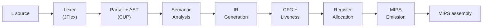

# L Compiler

An end-to-end compiler for **L**, a small statically typed, object-oriented language. Written in Java with **JFlex** and **CUP**, it takes L source code all the way to **MIPS assembly** that runs under the SPIM simulator.

```
L source  ──►  lexer  ──►  parser / AST  ──►  type checker  ──►  IR  ──►  CFG + liveness  ──►  register allocation  ──►  MIPS
```

---

## Highlights

- **Object-oriented language support:** classes, single inheritance, method overriding, and virtual dispatch through vtables
- **Static type checking** with nested scopes (block, function, class, global) and a scoped symbol table
- **Three-address intermediate representation** lowered from the AST, then partitioned into a **control-flow graph**
- **Liveness dataflow analysis** and **graph-coloring register allocation** of IR temporaries onto `$t0`–`$t9`
- **Heap-allocated objects, arrays, and strings** (concatenation and content equality)
- **16-bit saturating integer arithmetic**
- **Runtime safety checks** in the generated code: division by zero, null dereference, and array index out of bounds
- A **used-before-set dataflow analysis** over the CFG

---

## Table of Contents

1. [Example](#example)
2. [Quick Start](#quick-start)
3. [Compiler Output](#compiler-output)
4. [Architecture](#architecture)
5. [Tests](#tests)
6. [Project Structure](#project-structure)
7. [Language Reference](#language-reference)
8. [Author](#author)

---

## Example

**Input** ([input/TEST_12_Fib.txt](input/TEST_12_Fib.txt)):

```
int fib(int n) {
    if (n < 2) {
        return n;
    }
    return fib(n-1) + fib(n-2);
}

void main() {
    PrintInt(fib(9));
    return;
}
```

**Compile and run:**

```bash
java -jar COMPILER input/TEST_12_Fib.txt fib.s
spim -f fib.s
```

**Output:**

```
34
```

A larger object-oriented example:

```
array IntArray = int[];

class Point {
    int x;
    int y;
    void init(int px, int py) {
        x := px;
        y := py;
    }
}

void main() {
    Point p;
    p := new Point;
    p.init(3, 4);
    PrintInt(p.x);
}
```

---

## Quick Start

### Prerequisites

| Tool | Notes |
|---|---|
| **JDK** (8+) | `javac`, `java`, and `jar` on your `PATH` |
| **JFlex** | `jflex` on your `PATH` (`brew install jflex` / `sudo apt-get install jflex`) |
| **CUP** | Bundled in [external_jars/](external_jars/), nothing to install |
| **SPIM 8.0** | Runs the generated MIPS (`brew install spim` / `sudo apt-get install spim`) |

### Build

```bash
make
```

This produces `COMPILER`, an executable JAR, in the project root:

| Step | Action |
|---|---|
| 1 | Remove the old `COMPILER` and previously generated sources |
| 2 | JFlex generates `src/Lexer.java` from [jflex/LEX_FILE.lex](jflex/LEX_FILE.lex) |
| 3 | CUP generates `src/Parser.java` and `src/TokenNames.java` from [cup/CUP_FILE.cup](cup/CUP_FILE.cup) |
| 4 | `javac` compiles `src/**/*.java` into `bin/` |
| 5 | `jar` packages the classes and the CUP runtime into `COMPILER` |

### Run

```bash
java -jar COMPILER <input.l> <output.s>
spim -f <output.s>
```

Or build, compile [input/Input.txt](input/Input.txt) into `output/mips.txt`, and run it under SPIM in one step:

```bash
make everything        # SPIM output is written to output/MIPS_OUTPUT.txt
```

---

## Compiler Output

The output file contains exactly one of:

| Output | Meaning |
|---|---|
| `ERROR` | Lexical error |
| `ERROR(line)` | Syntax or semantic error at `line` |
| `Register Allocation Failed` | The interference graph needs more than 10 colors |
| MIPS assembly | Successful compilation |

---

## Architecture



| Phase | Package | Description |
|---|---|---|
| **Lexical analysis** | generated `Lexer` | JFlex-generated scanner. Any lexical error (malformed integer, illegal string character, unclosed comment) aborts with `ERROR`. |
| **Parsing** | `ast/` | A CUP LALR grammar builds an abstract syntax tree. Every node records its source line for error reporting. |
| **Semantic analysis** | `types/`, `symboltable/` | A recursive AST pass resolves names through nested scopes, checks types, inheritance, and overriding rules, and annotates the AST with type information. |
| **IR generation** | `ir/`, `temp/` | The AST is lowered to a linear list of three-address instructions over an unbounded set of temporaries: arithmetic, loads and stores, field and array access, calls, virtual calls, allocation, and jumps. |
| **CFG and dataflow** | `cfg/` | The IR is split into basic blocks forming a control-flow graph. Backward liveness analysis computes live-in and live-out sets. |
| **Register allocation** | `regalloc/` | An interference graph is built from the liveness sets and colored with Chaitin-style simplification onto 10 physical registers. |
| **Code generation** | `mips/` | `MipsGenerator` translates each IR instruction to MIPS: stack frames, vtables, heap allocation, saturating arithmetic, string runtime, and runtime error checks. |

---

## Tests

The repository ships with end-to-end tests:

- [input/](input/) holds the L test programs (`TEST_*.txt`): primes, bubble sort, merge lists, matrices, classes, strings, arrays, trees, recursion, operator precedence, overflow, access violations, register pressure, and more.
- [expected_output/](expected_output/) holds the expected SPIM output for each test (`TEST_*_Expected_Output.txt`), including the SPIM banner.

Run the whole suite after `make`:

```bash
mkdir -p output
pass=0; fail=0
for t in input/TEST_*.txt; do
  name=$(basename "$t" .txt)
  java -jar COMPILER "$t" "output/$name.s"
  spim -f "output/$name.s" > "output/$name.out"
  if diff -q "output/$name.out" "expected_output/${name}_Expected_Output.txt" > /dev/null; then
    pass=$((pass+1))
  else
    fail=$((fail+1)); echo "FAIL: $name"
  fi
done
echo "Passed: $pass  Failed: $fail"
```

---

## Project Structure

```
.
├── Makefile               # build / run targets
├── jflex/LEX_FILE.lex     # lexer specification
├── cup/CUP_FILE.cup       # grammar + AST construction
├── external_jars/         # CUP generator and runtime
├── manifest/MANIFEST.MF   # JAR entry point
├── input/                 # L test programs
├── expected_output/       # expected SPIM output per test
└── src/
    ├── Main.java          # driver: lexer → parser → semant → IR → CFG → RA → MIPS
    ├── Lexer.java         # ⟵ generated by JFlex
    ├── Parser.java        # ⟵ generated by CUP
    ├── TokenNames.java    # ⟵ generated by CUP
    │
    ├── ast/               # AST node hierarchy + semantic checks
    │   ├── AstNode.java       # base class, stores line number
    │   ├── AstDec*.java       # declarations (var, func, class, array)
    │   ├── AstStmt*.java      # statements (assign, if, while, return, call)
    │   ├── AstExp*.java       # expressions (binop, call, new, nil, int, string, var)
    │   ├── AstVar*.java       # variable access (simple, field, subscript)
    │   └── AstGraphviz.java   # debug: renders the AST with Graphviz
    │
    ├── types/             # type-system objects (int, string, class, array, function, nil, void)
    ├── symboltable/       # scoped symbol table (push/pop scopes, lookup chain)
    ├── temp/              # IR temporaries and their factory
    │
    ├── ir/                # IR instructions + AST → IR lowering
    │   ├── Ir.java            # IR instruction list builder
    │   ├── IrCommand.java     # abstract base
    │   └── IrCommand*.java    # binops, calls, virtual calls, loads/stores,
    │                          # field/array access, allocation, jumps, labels, prints
    │
    ├── cfg/               # control-flow graph + dataflow
    │   ├── CFG.java / CFGNode.java
    │   ├── LivenessAnalyzer.java
    │   └── UseBeforeDefAnalyzer.java
    │
    ├── regalloc/          # interference graph + graph-coloring allocator
    │   ├── InterferenceGraph.java
    │   ├── InterferenceBuilder.java
    │   └── RegisterAllocator.java
    │
    └── mips/
        └── MipsGenerator.java # IR → MIPS (frames, vtables, heap, syscalls, runtime checks)
```

---

## Language Reference

<details>
<summary><b>Lexical structure</b></summary>

| Category | Rule |
|---|---|
| **Identifiers** | Start with a letter, contain only letters and digits, and cannot be a reserved keyword |
| **Keywords** | `class nil array while int void extends return new if else string` |
| **Integers** | Digit sequences with no leading zeroes, in the range `[0, 2^15 − 1]`; out of range is a lexical error |
| **Strings** | Zero or more letters between double quotes; non-letter content or a missing closing quote is an error |
| **White space** | Spaces, tabs, and newlines are ignored |
| **Comments** | `// …` (line) or `/* … */` (block). Only letters, digits, whitespace, and `( ) [ ] { } ? ! + - * / . ;` are allowed inside. An unclosed block comment is an error |

| Token | Lexeme | Token | Lexeme |
|---|---|---|---|
| `LPAREN` | `(` | `ASSIGN` | `:=` |
| `RPAREN` | `)` | `EQ` | `=` |
| `LBRACK` | `[` | `LT` | `<` |
| `RBRACK` | `]` | `GT` | `>` |
| `LBRACE` | `{` | `ARRAY` | `array` |
| `RBRACE` | `}` | `CLASS` | `class` |
| `PLUS` | `+` | `RETURN` | `return` |
| `MINUS` | `-` | `WHILE` | `while` |
| `TIMES` | `*` | `IF` | `if` |
| `DIVIDE` | `/` | `ELSE` | `else` |
| `COMMA` | `,` | `NEW` | `new` |
| `DOT` | `.` | `EXTENDS` | `extends` |
| `SEMICOLON` | `;` | `NIL` | `nil` |
| `TYPE_INT` | `int` | `INT(v)` | integer literal |
| `TYPE_STRING` | `string` | `STRING(v)` | string literal |
| `TYPE_VOID` | `void` | `ID(v)` | identifier |

</details>

<details>
<summary><b>Grammar and operator precedence</b></summary>

Operator precedence, from lowest to highest:

| Level | Operator | Notes | Assoc |
|---|---|---|---|
| 1 | `:=` | assignment | — |
| 2 | `=` | equality | left |
| 3 | `<` `>` | comparison | left |
| 4 | `+` `-` | additive | left |
| 5 | `*` `/` | multiplicative | left |
| 6 | `[` | array subscript | — |
| 7 | `(` | function call | — |
| 8 | `.` | field access | left |

```bnf
program      ::= dec { dec }
dec          ::= varDec | funcDec | classDec | arrayTypedef

type         ::= TYPE_INT | TYPE_STRING | TYPE_VOID | ID

varDec       ::= type ID [ ASSIGN exp ] SEMICOLON
               | type ID ASSIGN newExp SEMICOLON

funcDec      ::= type ID LPAREN [ type ID { COMMA type ID } ] RPAREN
                 LBRACE stmtList RBRACE

stmtList     ::= stmt { stmt }

classDec     ::= CLASS ID [ EXTENDS ID ] LBRACE cField { cField } RBRACE
cField       ::= varDec | funcDec

arrayTypedef ::= ARRAY ID EQ type LBRACK RBRACK SEMICOLON

exp          ::= var
               | LPAREN exp RPAREN
               | exp (PLUS|MINUS|TIMES|DIVIDE|LT|GT|EQ) exp
               | callExp
               | [ MINUS ] INT | NIL | STRING

newExp       ::= NEW type
               | NEW type LBRACK exp RBRACK

callExp      ::= [ var DOT ] ID LPAREN [ exp { COMMA exp } ] RPAREN

var          ::= ID
               | var DOT ID
               | var LBRACK exp RBRACK

stmt         ::= varDec
               | var ASSIGN exp SEMICOLON
               | var ASSIGN newExp SEMICOLON
               | RETURN [ exp ] SEMICOLON
               | IF LPAREN exp RPAREN LBRACE stmtList RBRACE
                 [ ELSE LBRACE stmtList RBRACE ]
               | WHILE LPAREN exp RPAREN LBRACE stmtList RBRACE
               | callExp SEMICOLON
```

</details>

<details>
<summary><b>Types, scopes, and semantic rules</b></summary>

**Types**

| Category | Examples |
|---|---|
| Primitive | `int`, `string` |
| Class | `class Foo { … }`, `class Bar extends Foo { … }` |
| Array | `array IntArray = int[];` (over any previously declared non-void type) |
| Void | Only as a function return type |

- Every program must define a `void main()` entry point.
- Class and array definitions appear only at global scope.

**Scopes**

There are four scope levels: block (`if` / `else` / `while`), function, class, and global. Names resolve from the innermost scope outward. Inside a class body the search order is class → superclass chain → global.

- Each identifier may be declared only once per scope.
- Types, variables, and functions share a single namespace.
- Reserved keywords and primitive type names cannot be used as identifiers.

**Semantic rules**

| Rule | Detail |
|---|---|
| **Classes** | May only extend a previously defined class, so the hierarchy has no cycles |
| **Fields / methods** | No overloading. Overriding requires an exact signature match. Inherited fields cannot be shadowed |
| **Arrays** | Two array types over the same element type are distinct |
| **Operators** | `-` `*` `/` `<` `>` take integers only. `+` takes two ints or two strings. `=` takes comparable types. Division by the constant `0` is rejected |
| **Assignment** | `nil` can be assigned to class and array types but not to `int` or `string`. A subclass instance can be assigned to a superclass variable |
| **Conditions** | `if` and `while` conditions must be `int` |
| **Return** | A `void` function uses an empty `return`; a non-void function returns a type-compatible expression |
| **Library** | `void PrintInt(int i)` and `void PrintString(string s)` are predeclared |

</details>

<details>
<summary><b>Runtime semantics</b></summary>

**Integers.** Integers are 16-bit signed values in `[−2^15, 2^15 − 1]`, and arithmetic **saturates**:

```
a ⊙ b  =  −32768     if (a ⊙ b) < −32768
           32767     if (a ⊙ b) >  32767
           a ⊙ b     otherwise              for ⊙ ∈ {+, −, ×, /}  (floor division)
```

**Strings.** `+` concatenates into a new heap-allocated, null-terminated string. `=` compares contents and yields `1` or `0`.

**Classes and arrays.** `=` compares references.

**Conditions.** `0` is false; any other value is true.

**Evaluation order**

- Function arguments are evaluated left to right.
- Binary operations evaluate the left operand first.
- Global initializers run in source order before `main`.
- Class field initializers run at object construction and may only use constant literals (`int`, `string`, `nil`).

**Library functions**

```java
void PrintInt(int i)       // prints i followed by a space   (syscall 1)
void PrintString(string s) // prints s                       (syscall 4)
```

**Runtime errors.** The generated code detects these conditions, prints a message, and exits cleanly:

| Condition | Message |
|---|---|
| Division by zero | `Illegal Division By Zero` |
| Null dereference | `Invalid Pointer Dereference` |
| Array index out of bounds | `Access Violation` |

**SPIM syscalls used**

| Operation | MIPS |
|---|---|
| Print int | `li $a0,<n>` / `li $v0,1` / `syscall` |
| Print string | `la $a0,<label>` / `li $v0,4` / `syscall` |
| Allocate | `li $a0,<bytes>` / `li $v0,9` / `syscall` (address returned in `$v0`) |
| Exit | `li $v0,10` / `syscall` |

</details>

<details>
<summary><b>Register allocation</b></summary>

Registers are allocated per function over the IR temporaries:

1. **Liveness analysis.** Backward dataflow over the CFG computes live-in and live-out sets.
2. **Interference graph.** Two temporaries interfere if they are live at the same time.
3. **Simplification.** Nodes with degree < 10 are repeatedly removed and pushed onto a stack.
4. **Coloring.** Nodes are popped and given a register from `$t0`…`$t9` that no neighbor uses.
5. **Failure.** If a node cannot be colored, the compiler outputs `Register Allocation Failed`.

| Registers | Use |
|---|---|
| `$t0`–`$t9` | Allocated to IR temporaries (10 colors) |
| `$s0`–`$s9` | Scratch registers for the MIPS emitter |

Spilling and move coalescing are not implemented.

</details>

<details>
<summary><b>Used-before-set analysis</b></summary>

[cfg/UseBeforeDefAnalyzer.java](src/cfg/UseBeforeDefAnalyzer.java) is a conservative dataflow analysis, solved by chaotic iteration over the CFG. It reports variables that may be read before they are definitely initialized.

- A variable is **possibly uninitialized** at a use if some path from program entry reaches that use where the variable was never assigned, or where its latest assignment used an uninitialized value.
- Assigning from an expression that involves an uninitialized variable does **not** initialize the target.
- Global variables are evaluated in order before `main` is entered.

The analysis reports the offending variable names in sorted order. It is not invoked in the default compilation pipeline (see `Main.java`).

</details>

---

## Author

**Itay Hazan**
